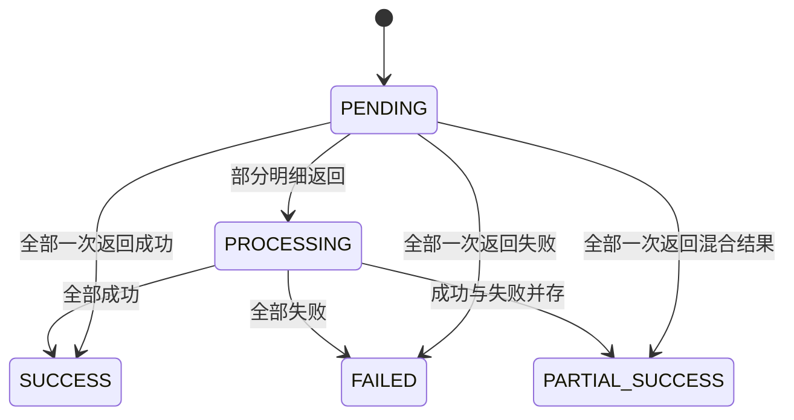

# Settlement Reconciliation Demo

用虚构订单演示：佣金计算 → 导入账单 → 差异核对 → 确认匹配项 → 接收模拟付款结果。
关注金额、业务唯一性和状态一致性。金额以 USD 十进制字符串传输，内部使用 BigDecimal。

## 快速开始

需要 JDK 21、Maven 3.6.3+。

```shell
mvn test
mvn spring-boot:run
```

打开 http://127.0.0.1:8081，依次点击“生成三笔订单”“导入”“确认匹配项”“模拟部分成功”。
再次点击导入、确认和付款结果，可观察同一业务身份返回原结果。
关闭服务再启动，`data/state.json` 中的状态保留。

```shell
mvn package
java -jar target/settlement-reconciliation-demo-1.0.0.jar
```

## 业务规则

- ORDER-001 / ORDER-003：本金 1000，固定 10%，应付 100。
- ORDER-002：本金 6000，达到 5000 阈值，阶梯档 8%，应付 480。
- 每笔先 HALF_UP 两位再汇总；订单保留规则版本、费率和金额快照。
- 输入账单是本演示专用 CSV：表头 `order_id,amount`，不支持引号、内嵌逗号；拒绝重复订单、负数和超过两位的小数。
- 四类结果：MATCHED、AMOUNT_MISMATCH、EXTERNAL_MISSING、SYSTEM_MISSING。
- **确认只支付匹配行**；差异行保留给人工处理，不会悄悄按外部金额付款。
- 业务唯一性：账单编号 + 规范化内容摘要；订单只能分配到一个付款批次。
- 回调事件 ID 与规范化结果绑定；重复事件返回原结果，重用 ID 修改内容会冲突。
- 付款成功/失败是终态，本版未实现失败明细的重新支付。

## API

| 方法 | 路径 | 用途 |
| --- | --- | --- |
| POST | /api/seed | 生成样例订单 |
| GET | /api/state | 查看订单、导入、付款、审计 |
| POST | /api/imports | `{billRef,csv}` 导入 |
| GET | /api/imports/{id} | 查看四类核对结果 |
| POST | /api/imports/{id}/confirm | 确认匹配行 |
| GET | /api/batches/{id} | 查看批次与明细 |
| POST | /api/batches/{id}/results | `{eventId,results:[{orderId,status,reason}]}` |

见 `demo.py`，启动服务后执行 `python demo.py` 可以跑完整接口演示。
接口演示使用同一组订单，请在全新数据目录运行，避免此前手工结算占用订单：
`mvn spring-boot:run -Dspring-boot.run.arguments="--demo.data-dir=./data-api"`。
`samples/differences.csv` 可演示全部四类差异；默认账单则用于两笔付款的部分成功场景。

## 验收证据

`src/test/.../AcceptanceChecks.java` 包含并发确认、跨账单重复分配、回调中途失败整体回滚、重复回调、终态冲突、全成功/全失败/部分成功、重启恢复和目录占用保护。
`AcceptanceTest` 将这些检查接入 `mvn test`，失败会使 CI 失败。



## 持久化和限制

本版使用单进程原子 JSON 快照：锁内复制状态 → 执行业务校验 → 写临时文件并 force → 原子替换 → 发布内存状态。
任何校验抛错都不提交副本；进程文件锁禁止两个实例操作同一个数据目录。
这是为方便复现选择的演示存储，**不是 SQL 数据库事务或分布式方案**。快照整体重写，适合少量数据；未实现迁移、WAL、进程外修改检测、银行接口、鉴权、自动差异调账或规则配置 UI。
生产实现可以替换为关系数据库事务、唯一约束和带签名的付款回调，本版没有把这些能力当作已完成。
默认只监听本机；不要将演示 API 直接作为线上服务。

技术参考：[Spring Boot 3.2.12](https://docs.spring.io/spring-boot/docs/3.2.12/reference/htmlsingle/)。

## 实现与验证说明

本项目为全新演示代码，使用虚构规则和样例，由作者结合业务经验、通过 AI 辅助实现。
已验证项目与受环境限制的检查见 [VERIFICATION.md](VERIFICATION.md)。
